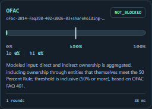
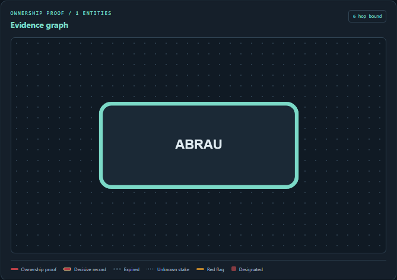
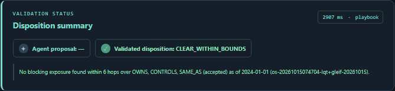

# The Clear Result That Wasn't Clear

*I built ShellTrace because the answer to “can we deal with this company?” is often hiding three companies away. Four days later, I had a graph that could explain the answer, a product that could remember when that answer changed, and a real-data evaluation that made me correct the way I was measuring it.*

I started with a question that sounds like it should take 10 seconds: **is this company sanctioned?**

Type a name into a list. No match. Clear, right?

That shortcut breaks in the cases that matter. A company can be absent from a sanctions list and still be owned, directly or through a chain of other companies, by a sanctioned party. Its answer can also change with the date and with the jurisdiction looking at it.

That was the whole bet behind ShellTrace: give an analyst a dated answer, show the ownership path that produced it, and leave a trail another analyst can check.

I built it for the WeMakeDevs × FalkorDB Graph Hacks hackathon, in the **Agents That Act on Connected Data** track. The public app is at [ShellTrace](https://frontend-five-opal-42.vercel.app). FalkorDB holds the connected facts and lets the product walk the relationships while preserving evidence, dates and reasoning.

## Day 1: turn the question into a graph

The first version was deliberately small. Companies became nodes. Ownership became edges. A designation became a dated fact. I added three policy views: OFAC, EU and UK.

Then came the first useful surprise. The same company can have a different answer under different rule packs. A 50% chain can cross the relevant threshold under the modeled OFAC rule, while the UK rule returns a different result because the interpretation is different.

That gave the product its first rule: never show one vague green or red badge. Show the rule pack, the date and the ownership path beside the result.

*One compact rule-pack card from the 18 October local ABRAU run. It makes the policy threshold and bounded interval readable without a page-long capture.*

The graph also had to admit when it did not know enough. A missing percentage cannot become a fake 0%. ShellTrace carries lower and upper ownership bounds, then returns `ESCALATE` when the evidence cannot support a clean answer.

I call this the **honest gap**. It is the space where a tool should ask for an analyst, not manufacture confidence.

## Day 2: the path needed evidence, not just a verdict

A graph result is only useful if somebody can challenge it.

So the next commits added dated tracing, accepted aliases, source citations, red flags and an evidence locker. Click an edge in the graph and the UI shows the source record, its dates, the ownership basis and the link back to the investigation.

That changed how I thought about the product. ShellTrace became an investigation record with a graph at its centre.

*A focused graph from the 18 October local ABRAU run. The article keeps synthetic demo cases and authentic source records visibly separate.*

Alias handling became one of the places where a smooth-looking product can become dangerous. A renamed company, a translated company name and a typo can all look close. They are not automatically the same legal entity.

ShellTrace therefore keeps an alias decision as a separate, reviewed step. An optional model can recommend a match, but it cannot merge entities or change a case verdict. A human decision, with a reason, does that.

## Day 3: let the agent investigate, but never let it decide the law

I wanted an agent because an analyst should be able to ask for an investigation in plain language and see it work through the case. I also did not want a language model doing ownership arithmetic or quietly issuing a legal conclusion.

The design ended up being simple:

1. The agent can call narrow, read-only investigation tools.
2. Every tool call appears in a hash-chained case timeline.
3. The graph and rule pack calculate the result.
4. A deterministic authoriser returns `EXPOSED`, `ESCALATE` or `CLEAR_WITHIN_BOUNDS`.

The model's answer is a labelled proposal. The validated result comes from evidence and deterministic checks.

That boundary is the second thing I would carry into another build. A model is good at choosing a route through a messy investigation. The calculation that changes a decision needs to remain inspectable.

*The bounded disposition stays separate from the agent proposal. It is a policy result, not legal advice.*

The Groq rehearsal made the design feel real: a live investigation of the synthetic hero case took **9.03 seconds**, recorded **15 timeline steps**, and returned a proposed and validated `EXPOSED` result. The demo still has a deterministic playbook, so the core investigation stays reproducible if the provider is unavailable.

## Day 4: a clearance should not be permanent by accident

Ownership and designation data changes. A case that was clear last week can become exposed after a new designation lands.

I added watched cases and change traversal for that reason. A user can watch a clearance. When a new designation is injected in the disclosed synthetic demo, ShellTrace follows the affected ownership paths, identifies impacted companies and reruns the saved case.

The useful moment comes when you open the diff and see the exact new proof that changed the result.

This part is where FalkorDB earned its place in the project. A relational table could store the individual facts. The product needs to start from one changed designation, traverse its connected impact, preserve dates and return evidence for every affected case. That is graph work.

## The correction that mattered most

By this point, the product looked finished. It had a polished UI, a live deployment, recorded browser runs and a synthetic suite of planted cases.

Then I looked harder at the real-data evaluation.

The earlier report counted structural candidates. It was not running the same production evaluation, trace and name-screen tools that the product used. It also risked treating a zero from an incomplete query as a real result.

That was too easy to present nicely and too weak to stand behind.

So I rebuilt the evaluation around a harder rule: hide a subject's own designation and accepted alias labels, then measure whether the graph still finds an ownership signal without leaking the answer into the test. It now calls the product's production tools, separates source dates from first-seen approximations, paginates past FalkorDB's 10,000-row result cap, and records unknowns as incomplete measurements instead of zeros.

*The fresh captures above come from a real-data local API run on 18 October. The blog deliberately uses focused panels rather than a shrunken full-page screenshot.*

The corrected local run found **7 eligible positives**, with **0 prediction errors**. Five used observation-date approximations and two used source listing dates. That sample is too small for headline percentages, so the product reports counts.

The data boundary matters just as much. The local graph holds 32,169 company and vessel nodes and 15,713 designations, but only **51** GLEIF relationships loaded because **4,256** parsed rows lacked a loaded endpoint. GLEIF accounting consolidation stays out of legal ownership totals. The GEM public export was unavailable during source research. These limits belong beside the result.

That correction became the third lesson: **measure the product with the product**, and say exactly where the data stops.

## What held up

After the correction, I ran the full local checks again:

| Check | Result |
| --- | --- |
| Backend suite | 354 passed, 2 skipped |
| Synthetic golden suite | 24/24 cases passed |
| Combined browser suite | 18 passed |
| Authentic-data browser checks | 5 runs, 35 API responses, all 200 |
| Live Groq rehearsal | 9.03 seconds, 15 steps, no fallback |

The ablations were useful too. Name screening alone passed **7 of 24** synthetic golden checks. The full graph-backed evaluation passed all **24 of 24**. Name screening and an ownership investigation answer different questions.

## What ShellTrace can and cannot say

ShellTrace is an investigation tool, not legal advice. It returns a cited, dated result within explicit rule-pack interpretations and a defined hop bound.

The public demo uses disclosed synthetic cases to show the complete workflow. A separate local workspace uses authentic OpenSanctions and GLEIF records with documented limits. A real company's own designation is not evidence that ShellTrace discovered an unlisted subsidiary. A flagged path is an investigative lead, not a final legal conclusion.

I think those boundaries make the demo stronger. The useful product is the one that knows when to show its work and when to ask for more evidence.

## What I will keep from this build

1. **Put the explanation beside the answer.** A verdict without an ownership path forces the next person to start from zero.
2. **Make time part of the query.** Dates shape the answer from the first query.
3. **Give the model a narrow job.** Let it investigate through tools, then validate the outcome with deterministic logic.
4. **Treat an uncertain edge as information.** Escalation is a useful answer when a percentage or source is missing.
5. **Publish the limits with the result.** Small real-data samples, missing endpoints and unavailable sources should remain visible.

Try the [live ShellTrace app](https://frontend-five-opal-42.vercel.app), then read the [repository](https://github.com/HarshdipSaha/shelltrace) for the graph model, Cypher queries, local setup and evaluation notes.

*Built for WeMakeDevs × FalkorDB Graph Hacks, October 2026. FalkorDB powers the graph traversal, evidence context, case memory and impact analysis. Groq assisted the optional investigation agent. AI coding tools assisted development and review. Sources, evaluation details and known limits are documented in the repository.*

---

## Publishing notes

This story follows the strongest pattern from the AWS Builder Center winning posts, including the article **“The Number Has an Age”** for Taaza Hawa: begin with a problem, show what fought back, report the correction, then give builders reusable lessons. ShellTrace is a FalkorDB project; AWS Builder Center is where I studied that blog shape.

Suggested title: **The Clear Result That Wasn't Clear: Building ShellTrace With FalkorDB**

Suggested subtitle: **A 4-day build journey from name screening to a cited, dated ownership investigation.**

Suggested cover prompt: `Editorial wide 16:9 illustration of an analyst tracing a hidden ownership chain through a connected company graph, deep navy background, white nodes, restrained orange-red risk node, clean premium technical magazine style, no text, no logos.`

The draft includes five images: one original cover illustration and four recorded product screenshots. Keep the authentic-data captions, credit OpenSanctions/GLEIF and retain their local-snapshot limitation when publishing.
